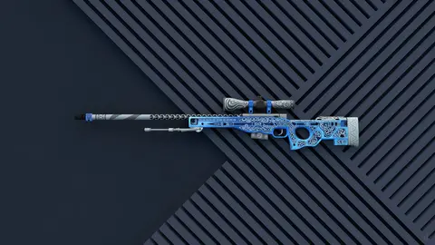
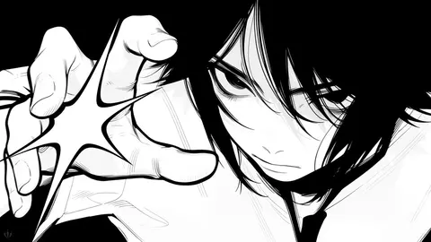

# Wallpapers

Coleção de wallpapers (desenhos e paisagens) em WebP, com nome único, mais o script que trata e publica as imagens novas.

## Galeria

<!-- galeria:inicio -->

233 wallpapers, mais recentes primeiro. Clica na miniatura pra abrir a imagem inteira.

<a href="imagens/c365ae4f7c6e.webp"></a>
<a href="imagens/a7635e4f7f68.webp"></a>
<a href="imagens/ff3514fc6af4.webp"></a>
<a href="imagens/729e5de0a9d4.webp"></a>
<a href="imagens/baee68ffb21b.webp"></a>
<a href="imagens/dc783f973cc5.webp"></a>
<a href="imagens/2c0984ce049e.webp"></a>
<a href="imagens/dfe8581efc9e.webp"></a>
<a href="imagens/f1671244fcd2.webp"></a>
<a href="imagens/578c5c51f36f.webp"></a>
<a href="imagens/547d6c355563.webp"></a>
<a href="imagens/76d491e7fa38.webp"></a>
<a href="imagens/fb18dbb683ab.webp"></a>
<a href="imagens/3071424886e8.webp"></a>
<a href="imagens/0900494f8b7e.webp"></a>
<a href="imagens/f5912a8c046a.webp"></a>
<a href="imagens/0bc28a72fdf3.webp"></a>
<a href="imagens/c567942167af.webp"></a>
<a href="imagens/329176b5691c.webp"></a>
<a href="imagens/0769642d48af.webp"></a>
<a href="imagens/174cefb2e54d.webp"></a>
<a href="imagens/baa804ad22b6.webp"></a>
<a href="imagens/5aed2b138fa6.webp"></a>
<a href="imagens/9d6caeb41806.webp"></a>
<a href="imagens/65d86050e9b3.webp"></a>
<a href="imagens/5ebdf92644ca.webp"></a>
<a href="imagens/74f2e9659623.webp"></a>
<a href="imagens/e0ce9e2215f1.webp"></a>
<a href="imagens/014637e6bb03.webp"></a>
<a href="imagens/b5150fdf93b5.webp"></a>
<a href="imagens/bb2ee6e571cb.webp"></a>
<a href="imagens/cec2b2f1fbf2.webp"></a>
<a href="imagens/b995fc08721d.webp"></a>
<a href="imagens/30ddf06e25d9.webp"></a>
<a href="imagens/ba90ad092d96.webp"></a>
<a href="imagens/d522dcc70be5.webp"></a>
<a href="imagens/7479d6e16d15.webp"></a>
<a href="imagens/dbe0f8ca027c.webp"></a>
<a href="imagens/c07b9bead6ba.webp"></a>
<a href="imagens/30bd637b873a.webp"></a>
<a href="imagens/c8e467cc9afc.webp"></a>
<a href="imagens/fb00d8b6b6a4.webp"></a>
<a href="imagens/a86e915471d0.webp"></a>
<a href="imagens/93748564cf6f.webp"></a>
<a href="imagens/826a7afeda4f.webp"></a>
<a href="imagens/1937525de185.webp"></a>
<a href="imagens/18225b67dc37.webp"></a>
<a href="imagens/eb2f136254e3.webp"></a>
<a href="imagens/c9558a82a6fa.webp"></a>
<a href="imagens/b0fc2207ec0f.webp"></a>
<a href="imagens/c1362e21e304.webp"></a>
<a href="imagens/0290862b4017.webp"></a>
<a href="imagens/06041c20d3be.webp"></a>
<a href="imagens/304088fb8a4a.webp"></a>
<a href="imagens/f305f0732549.webp"></a>
<a href="imagens/064ca0cea8fe.webp"></a>
<a href="imagens/0c40dadd2ec1.webp"></a>
<a href="imagens/103a7e434619.webp"></a>
<a href="imagens/16a12ab1f6d3.webp"></a>
<a href="imagens/2a767c0677b4.webp"></a>
<a href="imagens/62e32b5758b5.webp"></a>
<a href="imagens/72e53aade813.webp"></a>
<a href="imagens/743e362e419f.webp"></a>
<a href="imagens/90b600b55b68.webp"></a>
<a href="imagens/9127f3f96eca.webp"></a>
<a href="imagens/b9caf5f2e368.webp"></a>
<a href="imagens/bb67277548ba.webp"></a>
<a href="imagens/c015beadc24e.webp"></a>
<a href="imagens/cfa6a79481bb.webp"></a>
<a href="imagens/d0a11369e85f.webp"></a>
<a href="imagens/deab476874cc.webp"></a>
<a href="imagens/ebef756d0203.webp"></a>
<a href="imagens/04a3d3d41b34.webp"></a>
<a href="imagens/04e5bb08b4bb.webp"></a>
<a href="imagens/06680200e426.webp"></a>
<a href="imagens/085b4090290c.webp"></a>
<a href="imagens/0cdbf955f4ff.webp"></a>
<a href="imagens/0e185a22a7db.webp"></a>
<a href="imagens/0eba9d628fce.webp"></a>
<a href="imagens/10fc764e4189.webp"></a>
<a href="imagens/11d477391311.webp"></a>
<a href="imagens/138eecd6554b.webp"></a>
<a href="imagens/13b299bf60e4.webp"></a>
<a href="imagens/16d77e67ee48.webp"></a>
<a href="imagens/17078c4c2a31.webp"></a>
<a href="imagens/1711c73c1026.webp"></a>
<a href="imagens/17bc115b4fbb.webp"></a>
<a href="imagens/18422a68f942.webp"></a>
<a href="imagens/1c0bccea7db1.webp"></a>
<a href="imagens/1c53080cdff8.webp"></a>
<a href="imagens/21cb6424a3f4.webp"></a>
<a href="imagens/26d6591e3ad9.webp"></a>
<a href="imagens/27808d5c84b0.webp"></a>
<a href="imagens/2a2f4b299dac.webp"></a>
<a href="imagens/2c1696bf038c.webp"></a>
<a href="imagens/2e81b7464a58.webp"></a>
<a href="imagens/33a5829c1b69.webp"></a>
<a href="imagens/370ef2fa681b.webp"></a>
<a href="imagens/37321a9792ec.webp"></a>
<a href="imagens/37d14339ef5e.webp"></a>
<a href="imagens/3be58177a085.webp"></a>
<a href="imagens/3c0aee436a6a.webp"></a>
<a href="imagens/3dbf0de9dedb.webp"></a>
<a href="imagens/3e3d8abe804a.webp"></a>
<a href="imagens/3ea87c95ea6d.webp"></a>
<a href="imagens/3ee08deb86ad.webp"></a>
<a href="imagens/41b0267910ce.webp"></a>
<a href="imagens/4661fd7f3150.webp"></a>
<a href="imagens/479fbfb094e2.webp"></a>
<a href="imagens/4ac00aba5a49.webp"></a>
<a href="imagens/53291d4f4538.webp"></a>
<a href="imagens/583ed2f6d705.webp"></a>
<a href="imagens/5c1a2f224d29.webp"></a>
<a href="imagens/5d7bc75f66cc.webp"></a>
<a href="imagens/5d9c317d864b.webp"></a>
<a href="imagens/5f73793ec3ee.webp"></a>
<a href="imagens/61211cc05c2c.webp"></a>
<a href="imagens/62a19baf3a87.webp"></a>
<a href="imagens/62af0b9f30a8.webp"></a>
<a href="imagens/63b1ae9ab58d.webp"></a>
<a href="imagens/660df32428b4.webp"></a>
<a href="imagens/66927f22af04.webp"></a>
<a href="imagens/66f3960ce526.webp"></a>
<a href="imagens/69a6a5f0b547.webp"></a>
<a href="imagens/69d2a7154068.webp"></a>
<a href="imagens/6a05cf5ed792.webp"></a>
<a href="imagens/6a22844c0f41.webp"></a>
<a href="imagens/6a61a759490a.webp"></a>
<a href="imagens/6b1352b7d191.webp"></a>
<a href="imagens/6d1d95d5abcf.webp"></a>
<a href="imagens/6d55dc726306.webp"></a>
<a href="imagens/6e4061211451.webp"></a>
<a href="imagens/6f41003b28da.webp"></a>
<a href="imagens/70980201bc5a.webp"></a>
<a href="imagens/72fb7b66d096.webp"></a>
<a href="imagens/73db9f12d441.webp"></a>
<a href="imagens/765f36e3c569.webp"></a>
<a href="imagens/7786d5218f82.webp"></a>
<a href="imagens/78659df2afdf.webp"></a>
<a href="imagens/7933c56c8742.webp"></a>
<a href="imagens/79ab1bbccf74.webp"></a>
<a href="imagens/7a95e099a06f.webp"></a>
<a href="imagens/7bfebdfdb9db.webp"></a>
<a href="imagens/7c7ee7551c0f.webp"></a>
<a href="imagens/7e2f99a0e25b.webp"></a>
<a href="imagens/7f45edf9234c.webp"></a>
<a href="imagens/81d30a1d62fc.webp"></a>
<a href="imagens/83c98f689f03.webp"></a>
<a href="imagens/84fe77cd2e2c.webp"></a>
<a href="imagens/89f88b21e517.webp"></a>
<a href="imagens/8a9eeb9cd17a.webp"></a>
<a href="imagens/8b9a62a42150.webp"></a>
<a href="imagens/8b9faf94ec9a.webp"></a>
<a href="imagens/8bd7191c1205.webp"></a>
<a href="imagens/8e1e8de95033.webp"></a>
<a href="imagens/9411633a7231.webp"></a>
<a href="imagens/946b52da248e.webp"></a>
<a href="imagens/95090a74ee16.webp"></a>
<a href="imagens/95bd50651230.webp"></a>
<a href="imagens/978498dec5a0.webp"></a>
<a href="imagens/97d22dd2accf.webp"></a>
<a href="imagens/992c0ee5991b.webp"></a>
<a href="imagens/993cc5f284ab.webp"></a>
<a href="imagens/9e102ffe9f67.webp"></a>
<a href="imagens/9f5a55cde37b.webp"></a>
<a href="imagens/9f62fe9dac1a.webp"></a>
<a href="imagens/a0a12b1f7eca.webp"></a>
<a href="imagens/a0adc2157c44.webp"></a>
<a href="imagens/a102479a0f21.webp"></a>
<a href="imagens/a4a9984e3fe0.webp"></a>
<a href="imagens/abbe7ceab8d3.webp"></a>
<a href="imagens/ae1e052bdfb0.webp"></a>
<a href="imagens/af54e800176d.webp"></a>
<a href="imagens/b135f5cad4d7.webp"></a>
<a href="imagens/b2e7386256bd.webp"></a>
<a href="imagens/b3e9112f1b51.webp"></a>
<a href="imagens/b49a4653d352.webp"></a>
<a href="imagens/b6b43249e1b3.webp"></a>
<a href="imagens/b7a79651600d.webp"></a>
<a href="imagens/b812dc475e5d.webp"></a>
<a href="imagens/b832969fc472.webp"></a>
<a href="imagens/b866b0f37d46.webp"></a>
<a href="imagens/b8ac817f94c6.webp"></a>
<a href="imagens/b97693d3c8a9.webp"></a>
<a href="imagens/ba3f288879c9.webp"></a>
<a href="imagens/be0ddd649cde.webp"></a>
<a href="imagens/be3fc3d1107d.webp"></a>
<a href="imagens/beaf1958c1c6.webp"></a>
<a href="imagens/c1d4bce77e94.webp"></a>
<a href="imagens/c89bab96cf6d.webp"></a>
<a href="imagens/c917f2b505e2.webp"></a>
<a href="imagens/ce2e75fa2252.webp"></a>
<a href="imagens/d593dd01a8e2.webp"></a>
<a href="imagens/d6ed2595b313.webp"></a>
<a href="imagens/d8f926dcafdc.webp"></a>
<a href="imagens/d9333cae424b.webp"></a>
<a href="imagens/da39672b87a8.webp"></a>
<a href="imagens/dcf9da948759.webp"></a>
<a href="imagens/dd18162e9187.webp"></a>
<a href="imagens/dd827e399590.webp"></a>
<a href="imagens/de79abaef466.webp"></a>
<a href="imagens/dea794714a79.webp"></a>
<a href="imagens/deb425868d86.webp"></a>
<a href="imagens/e04c1fda5697.webp"></a>
<a href="imagens/e087642647a5.webp"></a>
<a href="imagens/e15dd57b5405.webp"></a>
<a href="imagens/e1ca313180ff.webp"></a>
<a href="imagens/e2dc47604922.webp"></a>
<a href="imagens/e53193e67b84.webp"></a>
<a href="imagens/e62166ab426a.webp"></a>
<a href="imagens/e692591bfabc.webp"></a>
<a href="imagens/eb6c2d8c2480.webp"></a>
<a href="imagens/ef1aa7defc4e.webp"></a>
<a href="imagens/efd94006ec34.webp"></a>
<a href="imagens/f06695d957e1.webp"></a>
<a href="imagens/f10e3748da05.webp"></a>
<a href="imagens/f152ac7b5018.webp"></a>
<a href="imagens/f3934a4f7880.webp"></a>
<a href="imagens/f3c795faecae.webp"></a>
<a href="imagens/f4529c331452.webp"></a>
<a href="imagens/f4532fd645b4.webp"></a>
<a href="imagens/f4819b075053.webp"></a>
<a href="imagens/f5369eea97aa.webp"></a>
<a href="imagens/f54087c81f43.webp"></a>
<a href="imagens/f72e9f86ddbb.webp"></a>
<a href="imagens/f7e1774201ab.webp"></a>
<a href="imagens/f8deec863e89.webp"></a>
<a href="imagens/f9445b648615.webp"></a>
<a href="imagens/f9a0e72c82b0.webp"></a>
<a href="imagens/fbcab7b310be.webp"></a>
<a href="imagens/fbcf9b769bf7.webp"></a>
<a href="imagens/fe1143fd8acf.webp"></a>
<a href="imagens/ff373cf91b7a.webp"></a>

<!-- galeria:fim -->

## Como funciona

1. Imagens novas entram na pasta `adicionar wallpapers/`.
2. Um agendamento (cron) roda o `processar.sh` a cada 15 min: converte pra WebP, gera a miniatura, atualiza a galeria acima e dá push.
3. Pra rodar na hora: `./processar.sh` (ou `IDADE_MIN=0 ./processar.sh` pra não esperar os 2 min).

- Nome do arquivo = 12 primeiros caracteres do SHA-256 do original. Nunca sobrescreve; imagem repetida é descartada.
- O formato é detectado pelo conteúdo do arquivo, não pela extensão (um PNG salvo como `.jpg` é tratado como PNG).
- O original é apagado depois de tratado. Só a versão WebP fica.
- Só pega arquivo parado há 2+ minutos, pra não processar uma cópia pela metade.
- `adicionar wallpapers/` não vai pro git.
- Imagem que der erro (arquivo corrompido, formato não suportado) vai pra `adicionar wallpapers/falhou/`.
- Log fica em `processar.log` (também fora do git).
- Apagar imagem do repo **não** libera espaço (o histórico guarda). Por isso tudo é convertido antes do commit.

## Conversão

Uma etapa só, do original direto pro WebP (sem recomprimir em cima de outra compressão):

1. Gira a foto conforme a orientação gravada pelo celular (EXIF).
2. Reduz o que passar de 3840 px no lado maior (só diminui).
3. Remove metadados (GPS, câmera, data).
4. Codifica em WebP qualidade 90. Se o original for PNG (desenho, arte chapada), testa também WebP sem perda e fica com o menor.

A miniatura da galeria (`previas/`) tem 480×270, recortada no centro.

Aceita JPG, PNG e WebP na entrada. GIF e outros vão pra `falhou/`.

## Usar como wallpaper

- **Windows 11 24H2 ou mais novo:** Configurações > Personalização > Plano de fundo aceita WebP direto.
- **Windows mais antigo:** abrir no app Fotos > "Definir como" > Plano de fundo.
- **Linux:** funciona (Hyprland/swww/hyprpaper, GNOME, KDE). No GNOME pode precisar do pacote `webp-pixbuf-loader`.
- **Android:** funciona.

Se algum programa não aceitar WebP, gera uma cópia em PNG (não mexe no original):

```bash
magick imagens/abc123.webp abc123.png
```

Converter todas:

```bash
mkdir -p convertidas
for f in imagens/*.webp; do
  magick "$f" "convertidas/$(basename "${f%.*}").png"
done
```

Com ImageMagick 6, o comando é `convert` em vez de `magick`.

## Montar numa máquina Linux

Precisa de bash 4+ e GNU coreutils (qualquer distro comum; macOS não).

```bash
# Debian/Ubuntu (no Arch: sudo pacman -S imagemagick git github-cli)
sudo apt install -y imagemagick git gh
gh auth login && gh auth setup-git
git clone <url-deste-repo> wallpapers
crontab -e   # adiciona a linha abaixo, trocando o caminho
# */15 * * * * /CAMINHO/wallpapers/processar.sh >> /CAMINHO/wallpapers/processar.log 2>&1
```

Pra soltar imagens de outro computador da rede, compartilha a pasta `adicionar wallpapers/` (Samba, NFS, etc.).
